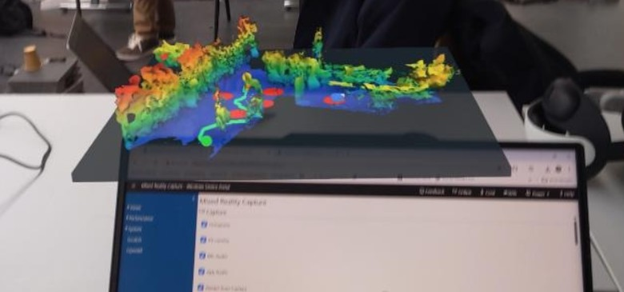
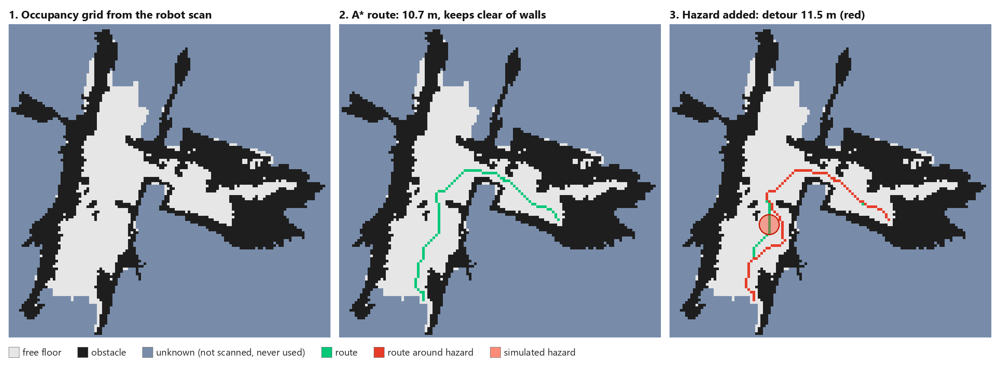

# WallSight: robot scan → safe route, in your hands

**A HoloLens 2 interface for robot-assisted indoor navigation.** A robot scans a building first. A person wearing a HoloLens 2 holds that scan as a tabletop hologram, **pinches** where they need to go, and gets a route that is **planned live on the robot's own map** and re-planned around danger zones, before anyone walks in.

Built in about a day at the **Mobile Robotics Hackathon 2026** (TU Dresden), track *Intuitive Human-Robot Interaction*, judged on usability, responsiveness and intuitiveness.


*Captured through the HoloLens 2 (Mixed Reality Capture): the robot's 3D scan anchored on a real table, with the planned route (green), simulated hazards (red) and the simulated robot (blue).*

## 🎥 Demo video

<!-- HOW TO ADD THE VIDEO: edit this file on github.com, drag the .mp4 (max 10 MB) onto this line,
     wait for the upload, and GitHub inserts a link that plays inline. Delete this comment afterwards.
     Longer video: upload to YouTube (unlisted) and use:
     [](https://www.youtube.com/watch?v=VIDEO_ID) -->
> _Video coming here: pinch to set a target, drag it, drop a hazard, watch the route and the robot re-plan._

---

## Contents
1. [The problem](#1-the-problem)
2. [What it does](#2-what-it-does)
3. [System overview](#3-system-overview)
4. [From robot scan to walkable map](#4-from-robot-scan-to-walkable-map)
5. [Route planning](#5-route-planning)
6. [Interaction on HoloLens 2](#6-interaction-on-hololens-2)
7. [Robot command stream](#7-robot-command-stream)
8. [Results](#8-results)
9. [Engineering challenges solved](#9-engineering-challenges-solved)
10. [Real vs simulated, and limitations](#10-real-vs-simulated-and-limitations)
11. [Run it yourself](#11-run-it-yourself)
12. [Repository structure](#12-repository-structure)
13. [Tech stack](#13-tech-stack)
14. [Next steps](#14-next-steps)

---

## 1. The problem
Rescuers and workers sometimes have to enter buildings they cannot see or do not know: smoke, darkness, an unfamiliar site. A robot can go in first and map the space, but the result is a 3D point cloud on a laptop, which a person under stress cannot read or act on.

**Goal:** turn the robot's map into something a person can understand at a glance and control with their hands, with no joystick, no 2D floor plan and no menus.

| Before | After |
|---|---|
| An operator reads a point cloud on a laptop and describes the way | Anyone holds the scan as a hologram, pinches the destination, and sees the safe route |

## 2. What it does
- **🗺️ The robot's scan as a hologram:** a real indoor scan recorded by a Boston Dynamics Spot (195,480 points, in metres) floats on the table in front of the user and stays anchored in the room while they walk around it.
- **👉 Pinch to route:** a ray comes out of the right hand with a cursor on the floor of the model. A pinch sets the target; pinch-and-hold lets the user drag it, and the route follows live.
- **🧭 Planning on the robot's own map:** A* on a 10 cm occupancy grid built from the scan. Routes keep clear of walls and stay in the middle of corridors, and **space the robot never saw is never used**.
- **🔥 Hazards:** a left-hand pinch drops a (simulated) danger zone. The route detours around it, or reports **"No safe route"** when the only doorway is blocked.
- **🤖 Robot side:** a simulated robot drives the planned route, and the goal, the path and motion commands stream out in ROS conventions for a robot to follow.
- **📝 Live status in the headset:** e.g. *"Route 10.7 m, planned on the robot's scan, avoiding 1 simulated hazard(s)"*.

## 3. System overview
```
 Boston Dynamics Spot scan (point cloud, metres)
        │   scripts/build_occupancy_grid.py      offline, once
        ▼
 Occupancy grid  ── 10 cm cells: free / obstacle / unknown ──┐
                                                             ▼
 Scan mesh ─────► Unity 6 (URP) ── RoutePlanner (A*, live) ──► route · hazards · simulated robot
                        │                                              │
                        │ OpenXR + Holographic Remoting                │ UDP / JSON (127.0.0.1:5005)
                        ▼                                              ▼
               HoloLens 2: head tracking,                 scripts/robot_bridge_listener.py
               hand ray + pinch, live status              /goal_pose /plan /cmd_vel /odom
```

All planning happens in the **scan's own metric frame** under the model's transform. The same route therefore works on the tabletop miniature (scale 0.04) and would work at 1:1, and the coordinates sent to the robot side are real metres in the robot's map, not positions of the miniature in the room.

## 4. From robot scan to walkable map
**Input:** [`data/hallway-001_clean.ply`](data/hallway-001_clean.ply), a cleaned Spot scan in metres with the floor levelled to y = 0.

[`scripts/build_occupancy_grid.py`](scripts/build_occupancy_grid.py) projects the points onto the floor plane in **10 cm cells**:

| Cell type | Rule | Why |
|---|---|---|
| **Free floor** | a point at height ≤ 0.10 m; small gaps closed (dilate + erode, 2 cells) | the scan is sparse on the floor |
| **Obstacle** | ≥ 3 points between 0.15 m and 1.50 m | ignores the floor and overhead structure; one noisy point is not a wall |
| **Unknown** | everything else | **never walkable**: the robot never saw it |

The result is **124 × 121 cells** (16 % free, 19 % obstacle, 66 % unknown), exported as compact JSON for Unity.


*Planner output on the real scan, with the same parameters as in Unity: (1) the grid, (2) a 10.7 m route through the doorway, (3) a hazard on the route forces an 11.5 m detour.*

## 5. Route planning
[`RoutePlanner.cs`](unity/Assets/WallSight/Scripts/RoutePlanner.cs)
- **A\***: 8-connected moves, octile heuristic, no diagonal corner-cutting past walls, binary-heap open list.
- **Clearance and comfort:** a multi-source BFS gives every cell its distance to the nearest non-free cell.
  - Cells within **1 cell (10 cm)** of a wall are blocked.
  - A soft cost over 4 cells pulls routes to the middle of corridors.
  - The clearance was chosen from the data: at 10 cm the two corridors stay connected through the doorway, at 20 cm they split.
- **Noise filter:** only the largest connected free area is walkable, so small floor fragments from scan noise can never become a target.
- **Snapping:** a tap snaps to the nearest walkable cell within 60 cm. A tap on unscanned space says *"the robot has not seen it"*.
- **Hazards:** a 0.4 m disc is blocked and a 0.4 m ring around it gets a high cost. The size was tuned so that one hazard narrows a 2 m corridor without closing it.
- **Verified before integration:** the planner was first ported to Python and run on the real grid, giving the routes in the figure above.

## 6. Interaction on HoloLens 2
| Input | Action |
|---|---|
| **Right hand:** point at the model's floor | white ray + yellow cursor |
| **Right hand:** pinch | set the target: route and robot appear |
| **Right hand:** pinch, hold, move | drag the target; the route re-plans live (throttled to ~8×/s) |
| **Left hand:** pinch | add / remove a simulated hazard |
| **Laptop:** R | place the model 1 m in front of the wearer again |

Implementation details:
- **No MRTK.** Hand input uses Unity Input System actions bound directly to the OpenXR *Microsoft Hand Interaction* profile (`<HoloLensHand>{RightHand}/pointerPosition`, `pointerRotation`, `selectPressed`, `isTracked`). The aim ray is intersected with the model's floor plane ([`HandRouteInput.cs`](unity/Assets/WallSight/Scripts/HandRouteInput.cs)).
- **Head tracking** from the centre-eye pose, updated every frame and again just before rendering ([`HeadPoseFollower.cs`](unity/Assets/WallSight/Scripts/HeadPoseFollower.cs)).
- **Placement:** the model appears 1 m ahead of the user's gaze, 0.35 m below eye level, once tracking is live ([`PlaceInFrontOfUser.cs`](unity/Assets/WallSight/Scripts/PlaceInFrontOfUser.cs)).
- **Rendering for an additive display:** pure black background (transparent on HoloLens), Single Pass Instanced, 16-bit depth submission for stable holograms.
- **Holographic Remoting** streams the Unity editor to the headset, so there is no 10–20 minute UWP build per iteration.
- **Desktop mode** for testing without a headset: right-click = target, Shift + right-click = start, H + right-click = hazard, C = clear hazards ([`RouteMouseInput.cs`](unity/Assets/WallSight/Scripts/RouteMouseInput.cs)).

## 7. Robot command stream
[`RobotCommandPublisher.cs`](unity/Assets/WallSight/Scripts/RobotCommandPublisher.cs) sends JSON lines over UDP. [`robot_bridge_listener.py`](scripts/robot_bridge_listener.py) receives them on the robot side:

| Message | When | Content |
|---|---|---|
| `goal` → `/goal_pose`, `/plan` | every route change (≤ 4 Hz while dragging) | target pose, full path, path length |
| `no_path` | the target is unreachable | robot holds position |
| `cmd` → `/cmd_vel`, `/odom` | 5 Hz, from the robot's actual motion | pose, linear m/s, angular rad/s, FORWARD / TURN_LEFT / TURN_RIGHT / STOP |

Coordinates are converted from Unity's left-handed frame to **ROS REP-103** (x forward, y left, z up): `x = z_unity`, `y = −x_unity`, `z = y_unity`, `yaw = −yaw_unity`.

Example of the output format (from a test run of the listener):
```
[INFO] [1791728280.115] [wallsight_robot_bridge] /goal_pose PoseStamped frame=scan_map  position x=+1.23 y=-2.50 z=+0.00 m
[INFO] [1791728280.116] [wallsight_robot_bridge] /plan Path 5 poses, 9.41 m: (-4.70,+2.70)  (-3.00,+2.50)  (-1.00,+1.90) ...
[INFO] [1791728280.316] [wallsight_robot_bridge] /cmd_vel Twist linear.x=+0.60 m/s angular.z=+0.00 rad/s  ^ FORWARD
[INFO] [1791728280.517] [wallsight_robot_bridge] /cmd_vel Twist linear.x=+0.60 m/s angular.z=+0.80 rad/s  < TURN LEFT
[INFO] [1791728280.717] [wallsight_robot_bridge] /plan no safe path to goal (blocked) -> robot holds position
```

## 8. Results
| Metric | Value |
|---|---|
| Scan size | 195,480 points |
| Occupancy grid | 124 × 121 cells at 10 cm |
| Example route / detour around one hazard | 10.7 m / 11.5 m |
| Doorway blocked | "No safe route" (no path through unknown space) |
| Re-planning while dragging | up to ~8 per second |
| Holographic Remoting frame rate | ~57 FPS (GPU 2.7 ms per frame) |
| Hand interaction | pinch to set, pinch-drag to move, second hand for hazards; no controllers, no menus |

## 9. Engineering challenges solved
- **HoloLens 2 on Unity 6.6.** Microsoft's recommended setup targets Unity 2022.3, so its *Mixed Reality OpenXR* plugin (1.11.2) did not compile on Unity 6.6. It is embedded in [`unity/Packages/com.microsoft.mixedreality.openxr`](unity/Packages/com.microsoft.mixedreality.openxr) with two minimal, marked patches:
  1. AR Foundation 6.6 introduced its own `XRMarker` / `XRMarkerSubsystem` types, which made `ARMarkerManager.cs` ambiguous (CS0104). Fixed with `using` aliases.
  2. `RenderGraphSettings.enableRenderCompatibilityMode` is read-only in Unity 6.6 (CS0200) inside an optional editor validation action. That assignment was removed; there's no runtime effect.
- **Unreliable venue network:** the plugin download kept aborting, so it was installed from a manually downloaded package.
- **Head tracking without bindings:** the editor-added Tracked Pose Driver had no default bindings, so the camera did not follow the head. Replaced with a small script reading the XR centre-eye pose.
- **Mirrored axes:** Unity's OBJ importer flips X. The scan mesh was pre-mirrored to match the point cloud, verified by comparing bounds and centroids of mesh and cloud, with an optional mirror switch in the planner.
- **Unity ↔ ROS frames:** explicit left-handed → right-handed conversion for everything sent to the robot side.

More detail: [`docs/technical-notes.md`](docs/technical-notes.md).

## 10. Real vs simulated, and limitations
| Real | Simulated / not yet |
|---|---|
| Spot's 3D scan, occupancy map, A* planning and re-planning | Hazards are placed by hand |
| HoloLens 2 head tracking, hand ray and pinch | The robot on the map is a marker, not a live robot |
| Goal / path / velocity commands, computed live and streamed | The bridge is a UDP process with ROS message formats, not a ROS 2 / Nav2 stack |
| | The scan is a recorded snapshot, not live mapping, and is not registered to the room the demo runs in |

Holographic Remoting streams over Wi-Fi, so fast head movements can briefly drop the image. A native UWP build removes that.

## 11. Run it yourself
**Requirements:** Windows · **Unity 6000.6.5f1** (Unity 6.6, URP) · for the headset: **HoloLens 2** with the free *Holographic Remoting Player*, on the same network as the PC · Python 3 with `numpy` and `Pillow` (only for rebuilding the grid).

1. Open the `unity/` folder in Unity Hub. The first import takes a few minutes.
2. **Desktop:** open `Assets/WallSight_NewModels.unity` and press Play. Use the mouse controls from section 6.
3. **HoloLens 2:** open `Assets/WallSight_XR.unity` and start the Holographic Remoting Player on the headset. In Unity: **Mixed Reality → Remoting → Holographic Remoting for Play Mode** → enter the IP the player shows → **Enable** → Play.
4. **Robot stream (optional):** `python scripts/robot_bridge_listener.py`, then Play.
5. **Rebuild the grid from the scan:**
   ```
   python scripts/build_occupancy_grid.py data/hallway-001_clean.ply unity/Assets/WallSight/Data/hallway-001_grid.json
   ```

## 12. Repository structure
```
├── unity/                         Unity 6.6 project
│   ├── Assets/WallSight/Scripts/  all WallSight C# (planner, hands, head tracking, robot, publisher)
│   ├── Assets/WallSight/Data/     occupancy grid (JSON)
│   ├── Assets/WallSightNew/       scan meshes + height-colour material
│   ├── Assets/WallSight_XR.unity  HoloLens scene
│   └── Packages/                  incl. the patched Mixed Reality OpenXR plugin
├── scripts/                       build_occupancy_grid.py, robot_bridge_listener.py
├── data/                          hallway-001_clean.ply (robot scan)
└── docs/                          technical notes, presentation guide, media
```

## 13. Tech stack
**XR:** HoloLens 2 · OpenXR 1.18 · Mixed Reality OpenXR plugin 1.11.2 · Holographic Remoting · Unity Input System
**Engine:** Unity 6 (6000.6.5f1) · URP · C# · TextMesh Pro
**Robotics:** occupancy grids · A* · ROS REP-103 frames · PoseStamped / Path / Twist message formats · UDP/JSON
**Data:** Python · NumPy · Pillow · binary PLY point clouds

## 14. Next steps
- Native HoloLens 2 build (no streaming).
- Live mapping from the robot instead of a recorded snapshot.
- Real hazard sensors (temperature, gas) instead of simulated zones.
- A ROS 2 node that forwards the stream to Nav2 on a real follower robot.
- Registering the scan 1:1 to the building for a walk-in view.

## Team
Built with a team at the Mobile Robotics Hackathon 2026, TU Dresden. The indoor scan was recorded with a Boston Dynamics Spot.

## License
MIT, see [LICENSE](LICENSE). Third-party packages keep their own licenses.
